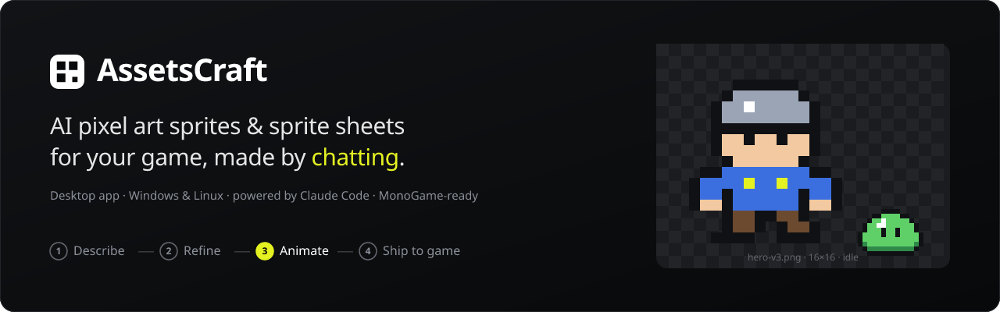
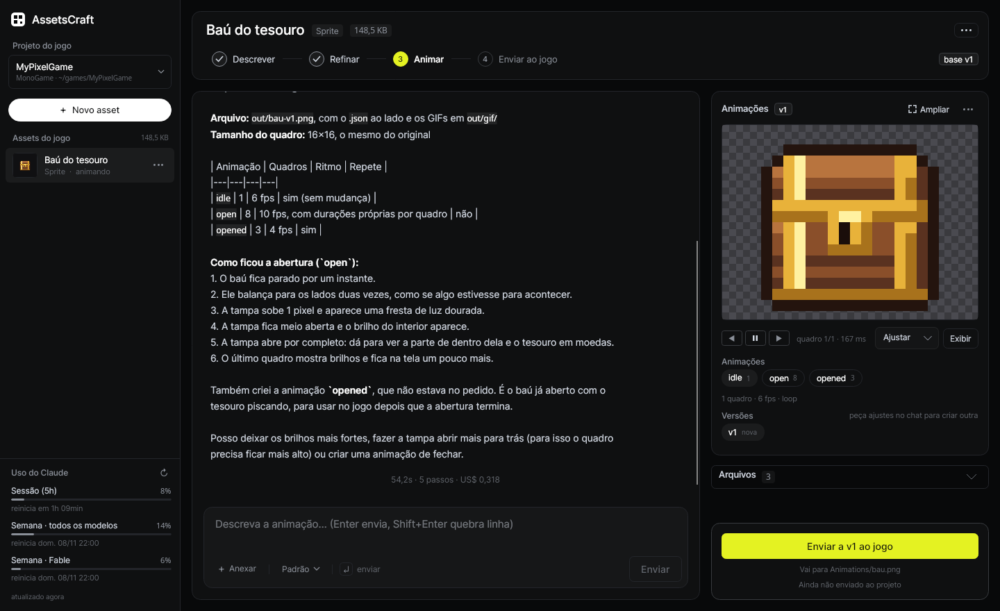
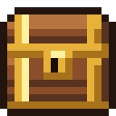
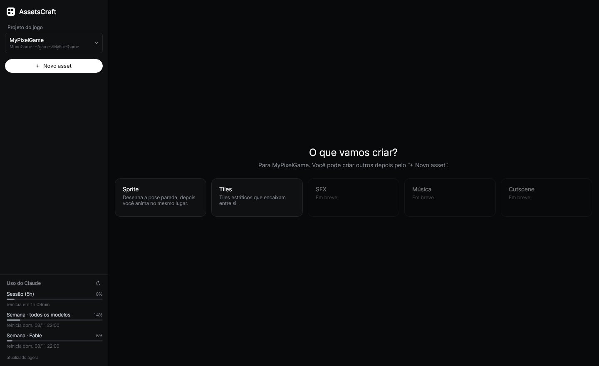

<div align="center">



# AssetsCraft

**Create pixel art sprites, sprite sheets and animations for your game just by describing them.**
A free, open-source desktop app for Windows and Linux, powered by [Claude Code](https://claude.com/claude-code).

[](https://github.com/P3droSoares/assetscraft/releases/latest)
[](LICENSE)


[](https://github.com/P3droSoares/assetscraft/stargazers)

[**Download**](#-download) · [**Quick start**](#-quick-start) · [**Features**](#-features) · [**FAQ**](#-faq) · [Português](README.pt-BR.md)

</div>

---

## What is AssetsCraft?

AssetsCraft is an **AI sprite generator** for indie game developers. You describe a character, an enemy, an item or
a tileset in plain words ("a 16×16 green slime, sweetie16 palette"), and Claude draws it **pixel by pixel**. You
watch it animate right next to the chat, ask for tweaks, then send the PNG straight into your game project.

It is made for **MonoGame** projects, but the output is a standard **PNG sprite sheet + Aseprite JSON**, so it works
with **Godot, Unity, Phaser, LÖVE, Defold** and any other engine.

<div align="center">

</div>

## ✨ Features

- **Chat to create game art.** Sprites, characters, enemies, items and seamless tilesets, all in crisp pixel art.
- **One straight path for each asset:** **Describe → Refine → Animate → Ship to game**, with a progress bar at the top.
- **Animations from your approved sprite.** Walk, jump, attack, idle… The design stays the same, so it looks like the same character moving.
- **Every tweak is a new version** (`v1`, `v2`, `v3`…). Nothing gets overwritten; compare versions and pick the best one.
- **Matches your game's art style.** AssetsCraft samples the PNGs already in your project (atlases, tilesets) and Claude follows their palette, outline, shading and size.
- **Pixel-perfect viewer.** Nearest-neighbour zoom, frame-by-frame playback, a checkerboard for transparency, a pixel grid and a full-sheet view.
- **Ship to game with one click, and undo it.** The PNG goes to `Content/Sprites`, `Content/Tiles` or `Content/Animations`, always after you confirm. **Remover do jogo** (remove from game) restores whatever was there before.
- **References and materials.** Drop in images, old sprites, palettes or even videos (frames are extracted with the bundled FFmpeg). Mark a file as inspiration only, or as material Claude should actually use.
- **Engine-friendly export.** PNG sheet, Aseprite JSON (frames + tags + durations) and one GIF per animation.
- **Uses your own Claude subscription.** No API key and no extra account. A usage meter shows your session and weekly limits.

<div align="center">

<br><sub>“Open the chest: it shakes twice, the lid rises and the gold shines.” — generated in AssetsCraft</sub>
</div>

## 📥 Download

| System | Download | Run |
|---|---|---|
| **Windows 10/11** (x64) | [AssetsCraft-win-x64.zip](https://github.com/P3droSoares/assetscraft/releases/latest/download/AssetsCraft-win-x64.zip) | Unzip, open `AssetsCraft.exe` |
| **Linux** (x64) | [AssetsCraft-linux-x64.tar.gz](https://github.com/P3droSoares/assetscraft/releases/latest/download/AssetsCraft-linux-x64.tar.gz) | `tar -xzf AssetsCraft-linux-x64.tar.gz && ./AssetsCraft/AssetsCraft` |

The builds are **self-contained**: you don't need to install .NET, and FFmpeg is included.
All versions are on the [Releases page](https://github.com/P3droSoares/assetscraft/releases).

> **Windows SmartScreen:** the app is not code-signed yet. If Windows warns you, click **More info → Run anyway**.

### Requirements

1. **[Claude Code](https://docs.claude.com/en/docs/claude-code/overview)** installed and logged in. Run `claude` once in a terminal to log in (a Claude Pro/Max subscription works).
2. **[Node.js 18+](https://nodejs.org/)**, which Claude Code needs anyway.
3. **Windows only:** [Git for Windows](https://git-scm.com/download/win), a requirement of Claude Code itself.

## 🚀 Quick start

1. **Open AssetsCraft** and click **Vincular projeto do jogo…** (link game project). Pick your game folder (for example, the folder with your MonoGame `.csproj`).
2. Click **+ Novo asset** (new asset) **→ Sprite** (or **Tiles**).
3. **Describe it:** *"Knight hero 32×32, pixel art, idle pose facing right, 1px dark outline"*. Press **Enter**.
4. **Refine:** *"make the armor darker and the sword bigger"*. Each request creates a new version.
5. Happy with it? Click **Animar a vN →** (animate vN) and ask for *"walk cycle, 6 frames, 10 fps"*.
6. Click **Enviar ao jogo** (ship to game), confirm, and the PNG is in your project's `Content/` folder.

> 🇧🇷 The interface is currently in **Brazilian Portuguese**. You can chat with Claude in English (or any language)
> and it answers in kind. English UI is on the roadmap. Contributions are welcome!

## 🧩 How it works

There is no official Claude Code SDK for C#, so AssetsCraft talks to the `claude` CLI directly, the same way the
official Agent SDKs do: headless mode with JSON over stdin/stdout (`--input-format stream-json --output-format stream-json`).
Each asset gets its own workspace with a small pixel-art toolchain (`tools/sprite.mjs`). Claude writes the sprite as
text-based pixel art (or SVG) and renders it into a PNG sheet, Aseprite JSON and GIFs. It then **looks at an
enlarged preview to check its own drawing** before answering.

<div align="center">

</div>

Want the details (architecture, sprite pipeline, configuration, data folders)? Read the
[technical documentation](docs/TECHNICAL.pt-BR.md) (in Portuguese).

## 🛠️ Build from source

```bash
git clone https://github.com/P3droSoares/assetscraft.git
cd assetscraft
scripts/fetch-ffmpeg.sh linux-x64            # once: bundled FFmpeg (optional for development)
dotnet run --project src/AssetsCraft.Desktop # run in development

scripts/publish.sh                           # self-contained builds in dist/linux-x64 and dist/win-x64
```

You need the **.NET 9 SDK** and **Node.js/npm** (npm installs the sprite toolchain that ships inside the app).
On Windows, use `.\scripts\publish.ps1`.

**Stack:** C# · .NET 9 · Avalonia UI 11 · CommunityToolkit.Mvvm · Node.js (pngjs, gifenc, resvg) · Claude Code CLI.

## ❓ FAQ

**Is it free?** Yes, AssetsCraft is free and open source (MIT). Claude usage counts against your own Claude subscription.

**Do I need an Anthropic API key?** No. It uses the Claude Code login that's already on your computer.

**Which game engines does it support?** Anything that loads PNGs. "Ship to game" is built for MonoGame's `Content/` folder, and the Aseprite JSON works in Godot, Unity, Phaser, LÖVE, Defold and others.

**Does it change my game's code?** No. It only copies PNG files into `Content/`, always after you confirm, and you can undo it. It never edits `Content.mgcb` or your code. Claude only sees a *copy* of your game's images, never the game folder itself.

**Can it edit or animate sprites I already have?** Yes. Attach your PNG and mark it **"usar no sprite"** (use in the sprite).

**macOS?** Not yet. Avalonia supports it, so a macOS build is possible. Help is welcome.

## 🤝 Contributing

Issues, ideas and pull requests are very welcome! Read [CONTRIBUTING.md](CONTRIBUTING.md) to get started.
If AssetsCraft helps your game, **give it a ⭐**. It helps other game developers find it.

## 📄 License

[MIT](LICENSE) © Pedro Cruz. AssetsCraft is an independent project and is not affiliated with Anthropic.
"Claude" and "Claude Code" are trademarks of Anthropic.

<sub>Keywords: AI sprite generator, pixel art generator, sprite sheet maker, game asset generator, AI game art,
tileset generator, sprite animation tool, MonoGame tools, indie game development, Claude Code app.</sub>
