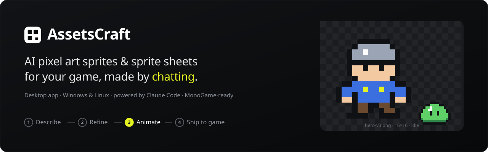
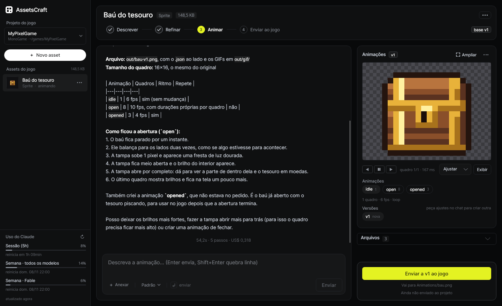
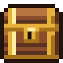
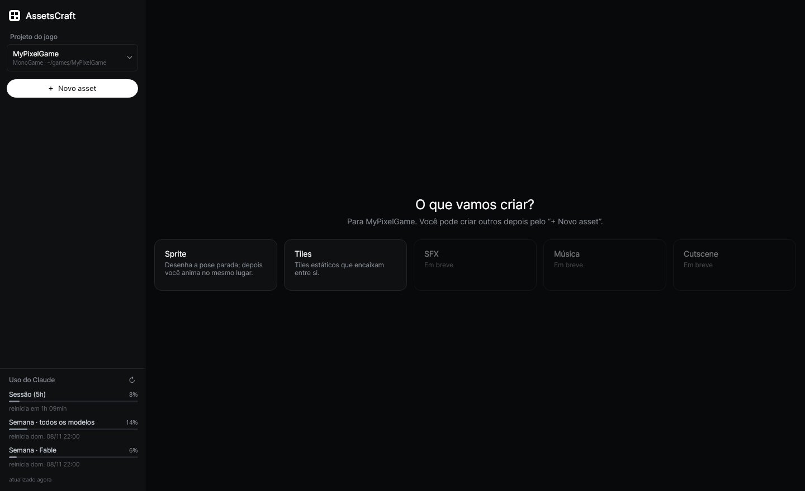

<div align="center">



# AssetsCraft

**Crie sprites, sprite sheets e animações em pixel art para o seu jogo só descrevendo o que você quer.**
App desktop gratuito e de código aberto para Windows e Linux, com o [Claude Code](https://claude.com/claude-code).

[](https://github.com/P3droSoares/assetscraft/releases/latest)
[](LICENSE)


[**Download**](#-download) · [**Começar**](#-começando) · [**Recursos**](#-recursos) · [**Dúvidas**](#-dúvidas-frequentes) · [English](README.md)

</div>

---

## O que é o AssetsCraft?

O AssetsCraft é um **gerador de sprites com IA** para quem faz jogos indie. Você descreve um personagem, inimigo, item
ou tileset com suas palavras ("slime verde 16×16, paleta sweetie16") e o Claude desenha **pixel a pixel**. O
resultado anima ao lado do chat; você pede ajustes e manda o PNG direto para o projeto do jogo.

Ele foi feito pensando em **MonoGame**, mas o resultado é um **PNG (sprite sheet) + JSON no formato Aseprite**. Por
isso funciona também com **Godot, Unity, Phaser, LÖVE, Defold** e qualquer outra engine.

<div align="center">

</div>

## ✨ Recursos

- **Converse para criar a arte do jogo:** sprites, personagens, inimigos, itens e tilesets que encaixam, em pixel art nítida.
- **Um caminho reto por asset:** **Descrever → Refinar → Animar → Enviar ao jogo**, com o progresso no topo.
- **Animações a partir do sprite aprovado:** andar, pular, atacar, idle… O design fica fixo e o personagem continua o mesmo.
- **Cada ajuste é uma nova versão** (`v1`, `v2`, `v3`…). Nada se perde: compare as versões e escolha a melhor.
- **Segue o estilo do seu jogo:** o app pega uma amostra dos PNGs do projeto (atlas, tilesets) e o Claude acompanha a paleta, o contorno, o sombreamento e o tamanho.
- **Paleta fixa do jogo:** envie uma paleta (`.png` do Lospec, `.hex`, `.gpl`, `.pal`, `.txt`) nas configurações do projeto (⚙). Todo sprite, tile e animação passa a usar só essas cores; qualquer cor de fora é trocada pela mais próxima ao gerar.
- **Visualizador pixel-perfect:** zoom sem borrar, quadro a quadro, fundo xadrez para a transparência, grade de pixels e folha inteira.
- **Envio ao jogo com um clique, e com volta:** o PNG vai para `Content/Sprites`, `Content/Tiles` ou `Content/Animations`, sempre com confirmação. **Remover do jogo** devolve o que estava lá antes.
- **Referências e materiais:** arraste imagens, sprites antigos, paletas e até vídeos (os quadros saem pelo FFmpeg embutido). Marque cada arquivo como "só inspiração" ou "usar no sprite".
- **Exportação pronta para engines:** folha PNG, JSON do Aseprite (quadros, tags e durações) e um GIF por animação.
- **Usa a sua assinatura do Claude:** sem chave de API e sem conta extra. Um medidor mostra os limites da sessão e da semana.

<div align="center">

<br><sub>“Abra o baú: ele balança duas vezes, a tampa sobe e o ouro brilha.” Gerado no AssetsCraft.</sub>
</div>

## 📥 Download

| Sistema | Download | Como abrir |
|---|---|---|
| **Windows 10/11** (x64) | [AssetsCraft-win-x64.zip](https://github.com/P3droSoares/assetscraft/releases/latest/download/AssetsCraft-win-x64.zip) | Descompacte e abra o `AssetsCraft.exe` |
| **Linux** (x64) | [AssetsCraft-linux-x64.tar.gz](https://github.com/P3droSoares/assetscraft/releases/latest/download/AssetsCraft-linux-x64.tar.gz) | `tar -xzf AssetsCraft-linux-x64.tar.gz && ./AssetsCraft/AssetsCraft` |

As versões são **completas**: não precisa instalar o .NET, e o FFmpeg já vem junto.
Todas as versões ficam na [página de Releases](https://github.com/P3droSoares/assetscraft/releases).

> **Windows SmartScreen:** o app ainda não tem assinatura digital. Se o Windows avisar, clique em **Mais informações → Executar assim mesmo**.

### O que você precisa ter

1. **[Claude Code](https://docs.claude.com/pt/docs/claude-code/overview)** instalado e logado. Rode `claude` uma vez no terminal para fazer login (serve a assinatura Claude Pro/Max).
2. **[Node.js 18+](https://nodejs.org/pt)**, que o Claude Code também usa.
3. **Só no Windows:** [Git for Windows](https://git-scm.com/download/win), exigência do próprio Claude Code.

## 🚀 Começando

1. **Abra o AssetsCraft** e clique em **Vincular projeto do jogo…**. Escolha a pasta do jogo (por exemplo, a do `.csproj` MonoGame).
2. Clique em **+ Novo asset → Sprite** (ou **Tiles**).
3. **Descreva:** *"Herói cavaleiro 32×32 em pixel art, pose parada olhando para a direita, contorno escuro de 1px"*. Aperte **Enter**.
4. **Refine:** *"deixe a armadura mais escura e a espada maior"*. Cada pedido cria uma nova versão.
5. Gostou? Clique em **Animar a vN →** e peça *"ciclo de caminhada, 6 quadros, 10 fps"*.
6. Clique em **Enviar ao jogo** e confirme. O PNG vai para a pasta `Content/` do seu projeto.

## 🧩 Como funciona

Não existe SDK oficial do Claude Code para C#. Por isso o AssetsCraft conversa direto com o CLI `claude`, do mesmo
jeito que os Agent SDKs oficiais: modo headless com JSON por stdin/stdout. Cada asset tem uma pasta de trabalho com
uma pequena ferramenta de pixel art (`tools/sprite.mjs`). O Claude escreve o sprite como pixel art em texto (ou SVG)
e renderiza a folha PNG, o JSON do Aseprite e os GIFs. Antes de responder, ele **olha uma prévia ampliada para
conferir o próprio desenho**.

<div align="center">

</div>

Quer os detalhes (arquitetura, pipeline de sprites, configuração, pastas de dados)? Veja a
[documentação técnica](docs/TECHNICAL.pt-BR.md).

## 🛠️ Compilar o código

```bash
git clone https://github.com/P3droSoares/assetscraft.git
cd assetscraft
scripts/fetch-ffmpeg.sh linux-x64            # uma vez: FFmpeg embutido (opcional no desenvolvimento)
dotnet run --project src/AssetsCraft.Desktop # rodar em desenvolvimento

scripts/publish.sh                           # gera dist/linux-x64 e dist/win-x64 (self-contained)
```

Você precisa do **.NET 9 SDK** e do **Node.js/npm** (o npm instala a ferramenta de sprites que vai dentro do app).
No Windows, use `.\scripts\publish.ps1`.

**Tecnologias:** C# · .NET 9 · Avalonia UI 11 · CommunityToolkit.Mvvm · Node.js (pngjs, gifenc, resvg) · Claude Code CLI.

## ❓ Dúvidas frequentes

**É de graça?** Sim. O AssetsCraft é gratuito e de código aberto (MIT). O uso do Claude conta na sua própria assinatura.

**Preciso de chave de API da Anthropic?** Não. O app usa o login do Claude Code que já está no seu computador.

**Funciona com qual engine?** Com qualquer uma que carregue PNG. O "Enviar ao jogo" foi feito para a pasta `Content/` do MonoGame, e o JSON do Aseprite funciona no Godot, Unity, Phaser, LÖVE, Defold e outras.

**Ele mexe no código do meu jogo?** Não. Só copia PNGs para `Content/`, sempre com confirmação e com como desfazer. Nunca edita o `Content.mgcb` nem o código. O Claude vê só uma *cópia* das imagens do jogo, nunca a pasta do jogo.

**Dá para editar ou animar sprites que eu já tenho?** Sim. Anexe o PNG e marque **"usar no sprite"**.

**E no macOS?** Ainda não. O Avalonia suporta, então uma versão para macOS é possível. Ajuda é bem-vinda.

## 🤝 Contribuindo

Issues, ideias e pull requests são muito bem-vindos! Veja o [CONTRIBUTING.md](CONTRIBUTING.md).
Se o AssetsCraft ajudou no seu jogo, **deixe uma ⭐**. Isso ajuda outros devs a encontrarem o projeto.

## 📄 Licença

[MIT](LICENSE) © Pedro Cruz. O AssetsCraft é um projeto independente, sem vínculo com a Anthropic.
"Claude" e "Claude Code" são marcas da Anthropic.

<sub>Palavras-chave: gerador de sprites com IA, gerador de pixel art, criador de sprite sheet, assets para jogos,
arte de jogo com IA, gerador de tileset, animação de sprites, ferramentas MonoGame, desenvolvimento de jogos indie.</sub>
